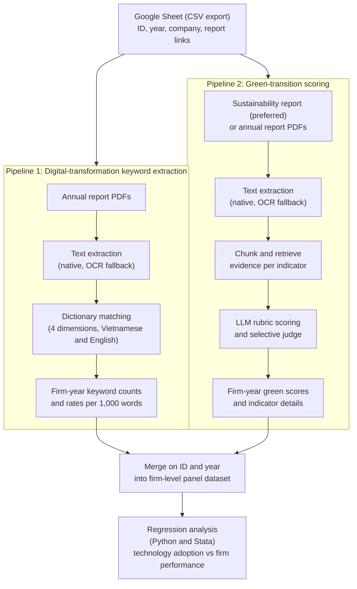
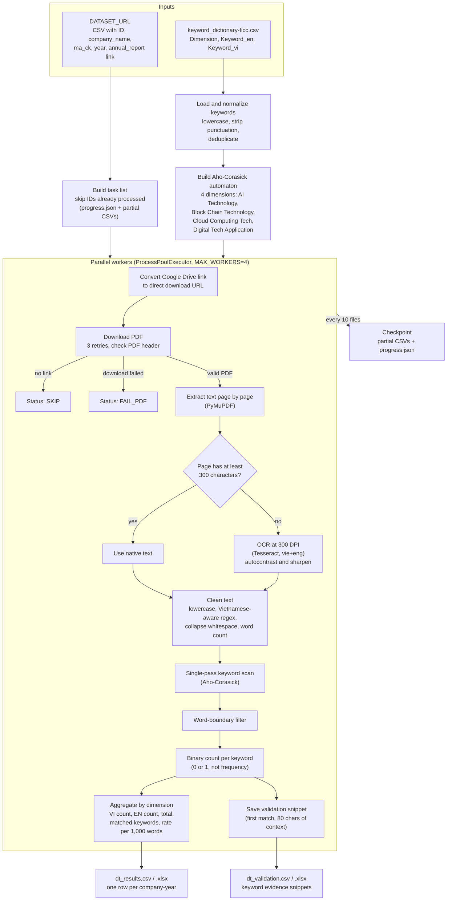
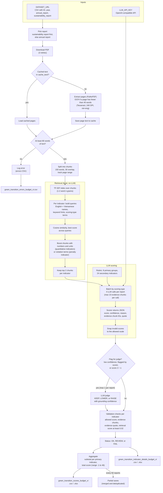

# Green Transition and Firm Performance in Vietnam

Research pipeline that turns Vietnamese annual and sustainability reports (PDFs) into firm-year measures of **digital transformation** and **green transition** disclosure, which are then used to study firm performance.

The repo contains two independent pipelines. Both read the same list of company reports (ID, year, report links) and each produces a firm-year dataset keyed by `ID` and `year`.

| Folder | What it measures | Method | Output |
|---|---|---|---|
| [`digital-transformation-keyword-extraction/`](digital-transformation-keyword-extraction) | Digital-transformation keyword mentions in annual reports | PDF text extraction, OCR fallback, dictionary matching (Aho-Corasick) | `dt_results`, `dt_validation` |
| [`green-transition-scoring/`](green-transition-scoring) | Green-transition disclosure quality (8 primary / 24 secondary indicators, score range -1 to 46) | PDF text extraction, OCR fallback, chunking, TF-IDF retrieval, LLM scoring, selective LLM judge | scores, indicator details, errors |

## Overview



> The merge and regression steps happen downstream of these scripts and are not part of this repo.

## Pipeline 1: Digital-transformation keyword extraction



## Pipeline 2: Green-transition scoring



### Scoring rubric

| Scoring type | Allowed scores | Primary indicators (secondary count) |
|---|---|---|
| Disclosure (binary) | 0 or 2 | Environmental Management (4), Information Disclosure Carriers (3) |
| Yes / No (binary) | 0 or 2 | Environmental Certification (4), Environmental Responsibility (1) |
| Description scale | 0 (none), 1 (qualitative), 2 (quantitative) | Environmental Liabilities (5), Performance and Governance (4), Green Innovation (2) |
| Negative penalty | -1 or 0 | Environmental Activities: violations, accidents, petitions (1) |

## Setup

Both pipelines need [Tesseract OCR](https://github.com/tesseract-ocr/tesseract) installed with the Vietnamese language data.

```bash
# Pipeline 1
cd digital-transformation-keyword-extraction
pip install -r requirements.txt
export DATASET_URL="your_google_sheet_csv_export_link"
python main.py

# Pipeline 2
cd green-transition-scoring
pip install -r requirements.txt
export DATASET_URL="your_google_sheet_csv_export_link"
export LLM_API_KEY="your_api_key"
python main.py
```

Optional environment variables: `TESSERACT_CMD`, `TESSDATA_DIR`, `MAX_WORKERS` (pipeline 1), `LLM_BASE_URL`, `LLM_MODEL`, `LLM_MODEL_SCORER`, `LLM_MODEL_JUDGE` (pipeline 2).
